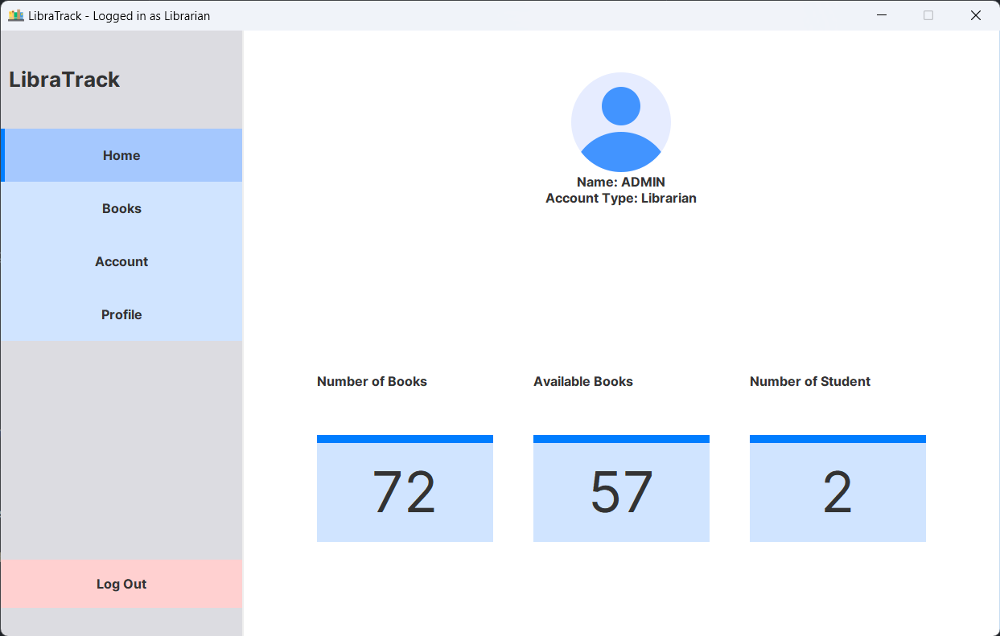

# LibraTrack · Library Management System

LibraTrack is a Java Swing desktop app for managing a library catalog and tracking loans. Librarians can manage books and student accounts. Students can browse, borrow, and return books.



## Run locally

Use JDK 21 and run from the repository root so the app can find its images and catalog.

```sh
mkdir -p out
find src -name '*.java' -print > out/sources.txt
javac -encoding UTF-8 -d out @out/sources.txt
java -cp out Main
```

You can also open the IntelliJ IDEA project, select your installed JDK, and run `src/Main.java` with the repository root as the working directory. Use **Sign Up** to create a local test account. The included catalog uses sample authors and publishers. The app stores accounts, remembered login details, and loans in local text files under `src/data/`. Use demo credentials and data.

## Source and license

Based on [AtifChy/Library-Management](https://github.com/AtifChy/Library-Management). Distributed under [GNU GPL v3](LICENSE).
